# Cardio ECE, un cardio-fréquencemètre PPG sur Arduino Nano

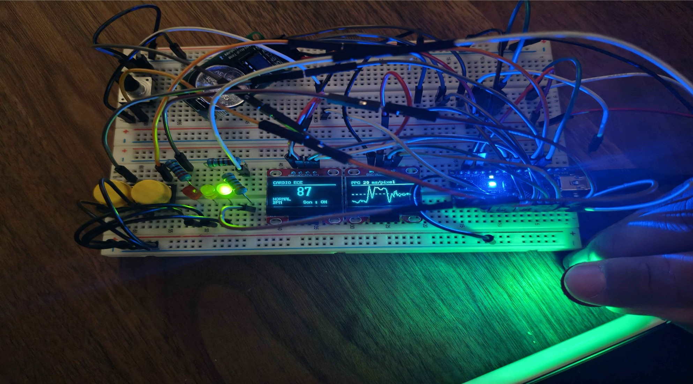

## Contexte

Projet d'électronique de ING2 à l'ECE Paris, réalisé en octobre 2026 par une équipe de 4.

## Fonctionnalités

**Mesure du rythme cardiaque**
- Capteur PPG WPSE340 sur `A0`, échantillonné toutes les 20 ms.
- Moyenne glissante sur 5 échantillons.
- Détection des battements par seuil adaptatif : le seuil est placé à 65 % de l'amplitude (min/max) mesurée sur une fenêtre de 4 s, avec une amplitude minimale de 30 points.
- 4 s de stabilisation au démarrage avant la première détection. Le BPM est remis à zéro si aucun battement n'est détecté pendant 2,5 s.
- Le BPM est la médiane des 5 derniers intervalles entre battements. Seuls les intervalles de 500 à 1500 ms sont retenus.
- Mesures valides entre 40 et 180 BPM.

**Indicateurs**
- LED jaune (< 60 BPM), verte (60-100 BPM) et rouge (> 100 BPM).
- Bip à chaque battement : 300 Hz, 600 Hz ou 1000 Hz selon la zone. On active ou coupe le buzzer avec le bouton de l'encodeur.

**Affichage**
- Deux écrans OLED SSD1306 128×64 en I2C, pilotés avec U8g2. Les deux sont à l'adresse `0x3C` : l'un est sur le bus I2C matériel, l'autre sur un bus I2C logiciel.
  - OLED 1 : date, heure, BPM, zone (BAS / NORMAL / ÉLEVÉ), état du son.
  - OLED 2 : courbe PPG avec la ligne de seuil.
- Encodeur rotatif :
  - en mode normal, il règle l'échelle du graphique (20, 40 ou 80 ms/pixel) ;
  - un appui long (1 s) ouvre le menu (Historique, Effacer EEPROM, Langue FR/EN, Quitter).

**Horloge et mémorisation**
- Horloge RTC DS1302 (DAT/CLK/RST sur D7/D6/D5).
- Bouton `A1` : le montage enregistre en EEPROM la moyenne des 10 prochaines mesures valides, avec la date et l'heure. Chaque enregistrement contient un octet de contrôle.
- Consultation des mesures sur l'OLED 1 (menu Historique) ou dans le moniteur série (commande `H`, 115200 bauds).
- Effacement des mesures en maintenant `A2` pendant 2 s, ou depuis le menu.

## Matériel

| Composant | Quantité | Rôle |
|---|---|---|
| Arduino Nano (ATmega328P) | 1 | Microcontrôleur |
| Capteur PPG WPSE340 | 1 | Mesure du pouls au doigt |
| Écran OLED SSD1306 128×64 I2C | 2 | Affichage BPM/heure et courbe PPG |
| Module RTC DS1302 (avec pile CR2025) | 1 | Date et heure |
| LED jaune, verte, rouge | 3 | Zone de fréquence cardiaque |
| Résistance 220 Ω | 3 | R1 à R3 sur le schéma |
| Buzzer | 1 | Bip à chaque battement |
| Encodeur rotatif avec bouton | 1 | Échelle du graphique, menu, buzzer |
| Bouton poussoir | 2 | Enregistrement (`A1`) et effacement (`A2`) |
| Breadboard et câbles | – | Montage |

## Câblage

Le câblage de référence est celui du code final, testé sur le montage. La colonne « Net » correspond aux labels du schéma KiCad.

| Broche Nano | Composant | Net (schéma) |
|---|---|---|
| A0 | WPSE340 : signal | `PPG_OUT` |
| A4 | OLED 1 : SDA (I2C matériel) | `I2C_SDA` |
| A5 | OLED 1 : SCL (I2C matériel) | `I2C_SCL` |
| D8 | OLED 2 : SDA (I2C logiciel, adresse 0x3C) | `OLED2_SCL_D8` |
| D9 | OLED 2 : SCL (I2C logiciel, adresse 0x3C) | `OLED2_SDA_D9` |
| D7 | RTC DS1302 : DAT | `RTC_DAT` |
| D6 | RTC DS1302 : CLK | `RTC_CLK` |
| D5 | RTC DS1302 : RST (CE) | `RTC_CE` |
| D10 | LED rouge (via 220 Ω) | `LED_RED` |
| D11 | LED verte (via 220 Ω) | `LED_GREEN` |
| D12 | LED jaune (via 220 Ω) | `LED_YELLOW` |
| D13 | Buzzer | `BUZZER` |
| D2 | Encodeur : A (interruption) | `ENC_A` |
| D3 | Encodeur : B (interruption) | `ENC_B` |
| D4 | Encodeur : bouton | `ENC_SW` |
| A1 | Bouton d'enregistrement (vers GND, pull-up interne) | `SAVE_SW` |
| A2 | Bouton d'effacement (vers GND, pull-up interne) | `ERASE_SW` |
| 5V / GND | Alimentation commune | `+5V` / `GND` |

> Note : le schéma KiCad inverse les étiquettes SDA/SCL de l'OLED 2. Il indique aussi par erreur l'adresse 0x3D pour cet écran.

## Organisation du dépôt

```
cardio-ece/
├── code/
│   ├── final/Code_Final_avec_modules_optimise/   ← version finale
│   └── versions-anterieures/                     ← Code_v1, Code_v2
├── tests/                                        ← tests unitaires par module
│   ├── capteur-ppg/   (Test_WPSE340, Test_v2, Test_v3)
│   ├── rtc/           (Test_RTC, Test_RTC_v2)
│   ├── oled/          (Test_OLED)
│   └── eeprom/        (Test_EEPROM)
├── schema/            ← schéma électrique KiCad
├── docs/              ← architecture, algorigramme, schéma électrique (images)
├── photos/            ← photos du montage et des tests
└── captures/          ← captures du moniteur et du traceur série
```

`code/final/` contient la version finale du programme. `code/versions-anterieures/` et `tests/` contiennent les versions précédentes et les tests unitaires de chaque module. Ils sont conservés pour montrer la démarche.

### Chronologie

Les dates sont les dates de dernière modification des fichiers originaux.

| Date | Fichier | Ce qu'il apporte |
|---|---|---|
| 03/10/2026 | `tests/capteur-ppg/Test_WPSE340` | Lecture brute du capteur sur A0 toutes les 20 ms, envoyée au traceur série. |
| 05/10/2026 | `tests/capteur-ppg/Test_v2` | Moyenne glissante sur 5 échantillons, seuil adaptatif (65 % de l'amplitude sur 4 s) et BPM calculé sur un seul intervalle. |
| 06/10/2026 | `tests/capteur-ppg/Test_v3` | 4 s de stabilisation, amplitude minimale de 30 et BPM = médiane des 5 derniers intervalles (500-1500 ms). |
| 06/10/2026 | `tests/rtc/Test_RTC` | Réglage et lecture du DS1302 avec la bibliothèque `Ds1302`. |
| 07/10/2026 | `tests/oled/Test_OLED` | Deux OLED à la même adresse `0x3C`, l'un en I2C matériel, l'autre en I2C logiciel. |
| 07/10/2026 | `tests/eeprom/Test_EEPROM` | Écriture, lecture et effacement d'une mesure datée en EEPROM (commandes série `w` / `r` / `e`). |
| 08/10/2026 | `code/versions-anterieures/Code_v1` | Première intégration du capteur, de la RTC et des deux OLED : date, heure, BPM et courbe. Filtre passe-bas exponentiel et BPM moyen sur 5 intervalles. |
| 08/10/2026 | `code/versions-anterieures/Code_v2` | Ajout des LED, du buzzer, de l'encodeur (échelle du graphique) et des boutons `A1`/`A2` pour sauvegarder et effacer le BPM en EEPROM (10 emplacements). |
| 09/10/2026 | `tests/rtc/Test_RTC_v2` | Passage à la bibliothèque Rtc by Makuna (`ThreeWire`, `RtcDS1302`), avec vérification de la validité de la date et de l'oscillateur. |
| 11/10/2026 | `code/final/Code_Final_avec_modules_optimise` | Version finale. Elle reprend l'algorithme de `Test_v3` et ajoute l'encodeur sur interruptions, le menu OLED (historique, effacement, langue), la moyenne de 10 mesures datées avec contrôle d'intégrité, la consultation série et un rafraîchissement OLED non bloquant. |

## Tests

### Captures

| | |
|---|---|
| 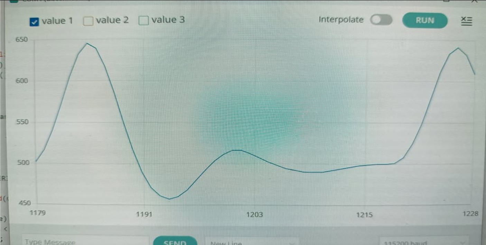 | Signal du WPSE340 dans le traceur série de l'IDE Arduino. |
| 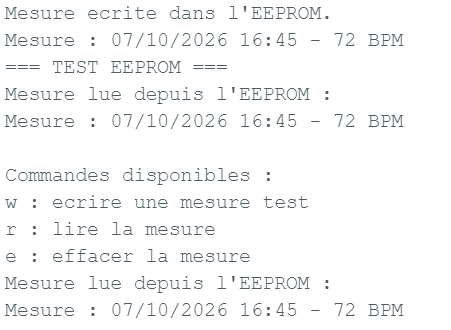 | `Test_EEPROM` : une mesure écrite puis relue après redémarrage. |
| 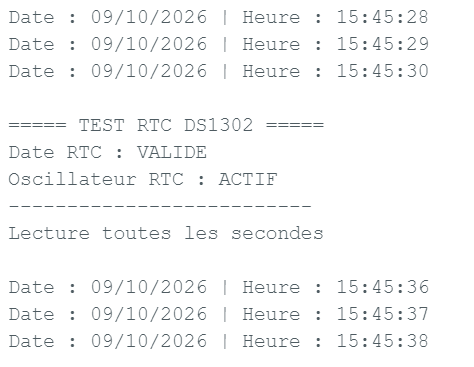 | `Test_RTC_v2` : la date est valide, l'oscillateur est actif et la lecture se fait chaque seconde. |

### Photos

| | |
|---|---|
| 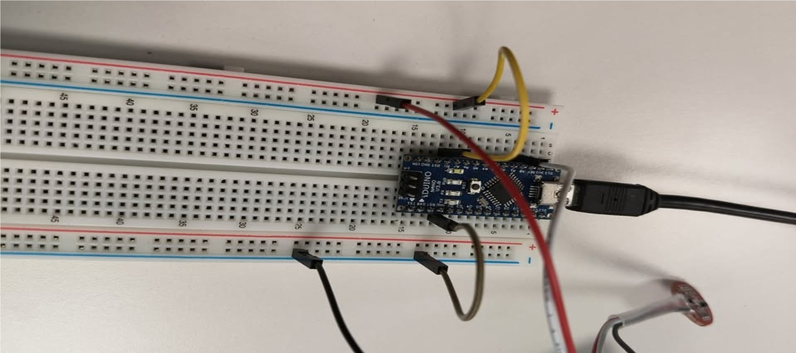 | Premier câblage de l'Arduino Nano et du capteur PPG. |
| 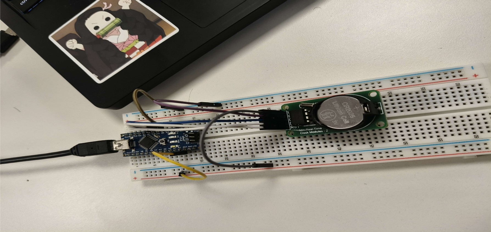 | Test du module RTC DS1302. |
| 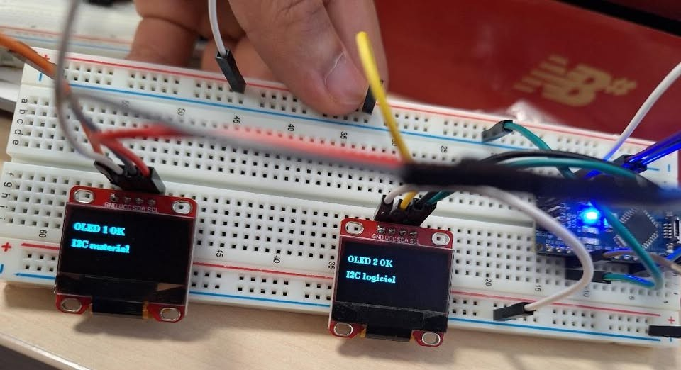 | `Test_OLED` : les deux écrans fonctionnent, l'un en I2C matériel et l'autre en I2C logiciel. |
| 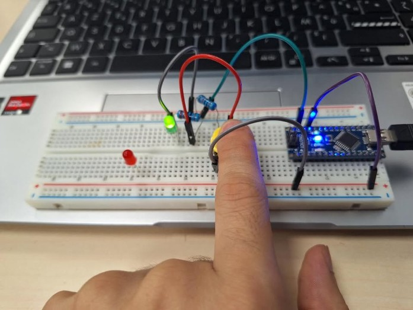 | Test des LED avec un bouton : LED verte. |
| 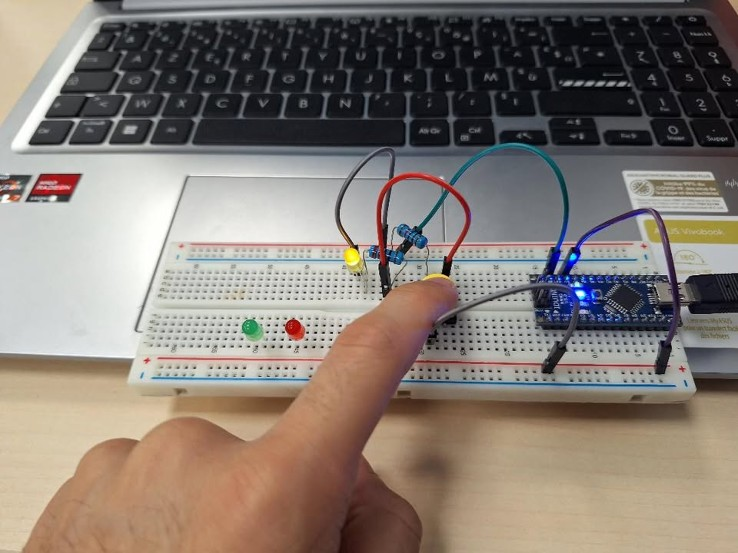 | Test des LED avec un bouton : LED jaune. |
| 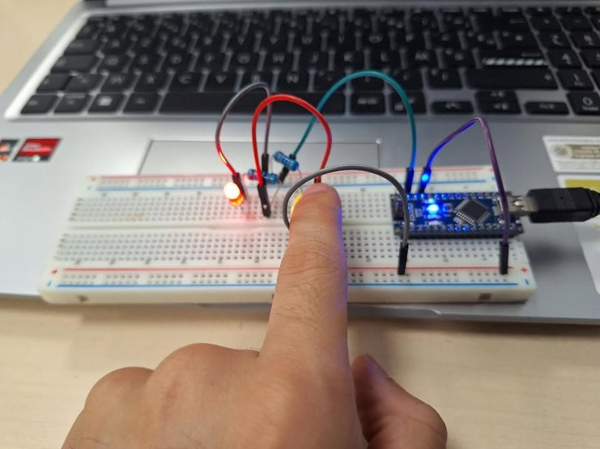 | Test des LED avec un bouton : LED rouge. |

## Conception

**Architecture matérielle**

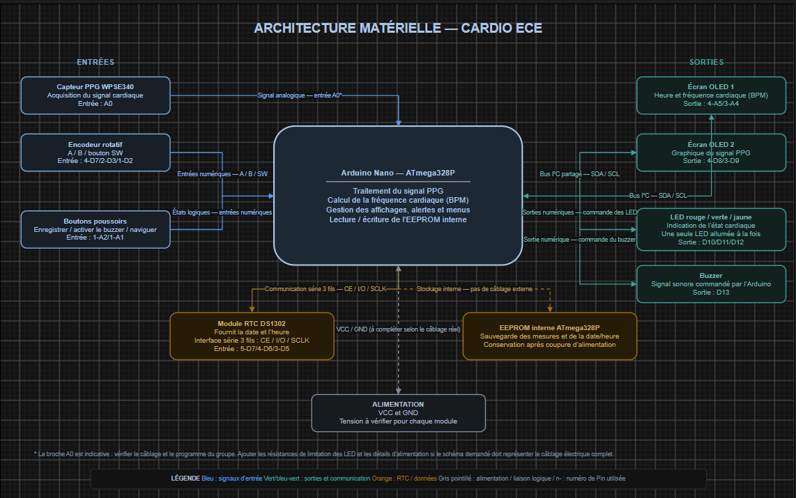

*Document de conception préliminaire. Le câblage final est celui de la section [Câblage](#câblage), avec des bus I2C séparés.*

**Algorigramme**

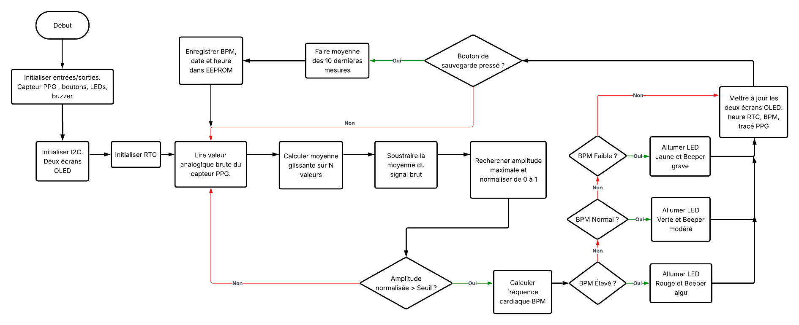

**Schéma électrique** (source KiCad : [`schema/cardio_ppg_schema_complet_reel.kicad_sch`](schema/cardio_ppg_schema_complet_reel.kicad_sch))

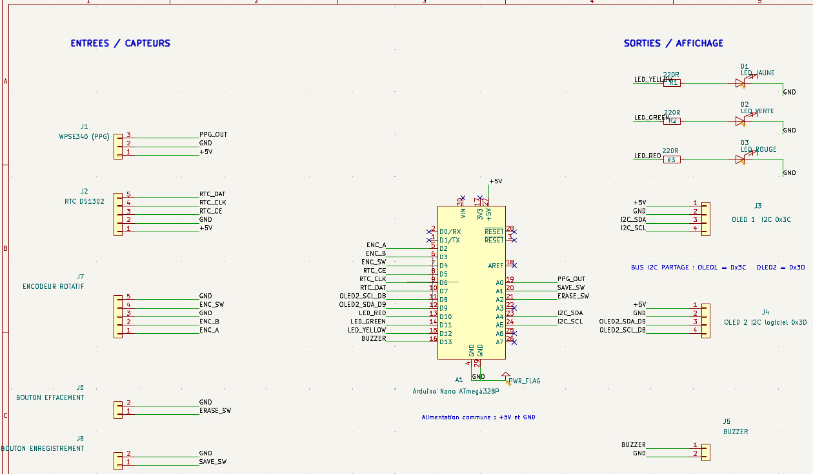

## Installation

1. Installer l'[IDE Arduino](https://www.arduino.cc/en/software).
2. Dans le gestionnaire de bibliothèques (*Outils → Gérer les bibliothèques*), installer :
   - **U8g2** (olikraus) pour les écrans OLED ;
   - **Rtc by Makuna** pour le DS1302 (`ThreeWire.h`, `RtcDS1302.h`).

   `Wire` et `EEPROM` sont fournies avec l'IDE. Les anciennes versions (`Code_v1`, `Code_v2`, `Test_RTC`) utilisent en plus la bibliothèque `Ds1302` (`Ds1302.h`).
3. Ouvrir `code/final/Code_Final_avec_modules_optimise/Code_Final_avec_modules_optimise.ino`.
4. Choisir la carte **Arduino Nano**, le processeur **ATmega328P** (ou *ATmega328P (Old Bootloader)* selon la carte) et le bon port COM.
5. Téléverser, puis ouvrir le moniteur série à **115200 bauds**.

Le code final ne règle pas l'heure de la RTC, il lit seulement l'heure déjà enregistrée. Pour la régler, il faut d'abord téléverser `tests/rtc/Test_RTC` avec `REGLER_HEURE = true` et la date voulue.

## Mon rôle

J'ai pris en charge le montage et le développement du code final. Le schéma électrique et les documents de conception ont été réalisés par mes coéquipiers.

## Équipe

Mickaël, Selim, Yohan et moi.

## Limites et pistes d'amélioration

**Limites**
- La mesure est sensible aux mouvements, à la position du doigt et à la lumière ambiante.
- Seuls les intervalles de 500 à 1500 ms sont retenus. Le code ne peut donc pas mesurer plus de 120 BPM, même si l'affichage accepte jusqu'à 180 BPM.

**Pistes**
- Un traitement du signal plus avancé.
- Une communication sans fil.
- Plus de stockage.

## Licence

Le code des dossiers `code/` et `tests/` est distribué sous licence MIT (voir [`LICENSE`](LICENSE)), © 2026 Équipe Cardio ECE.

Les dossiers `schema/` et `docs/` ne sont pas couverts par cette licence et restent la propriété de leurs auteurs.
